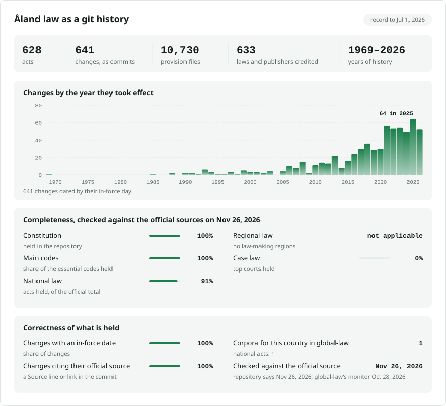

# Åland: law history in git

**English** · **[Eller läs den på svenska](README.md)**

<picture>
<source media="(prefers-color-scheme: dark)" srcset="data/effort-dark.svg">

</picture>

The law of Åland as a git history: one file per section (paragraf), one commit per version on the day it took effect, and the act that made each change as the commit's author. `git blame` names the act behind every line; `git log` lists every change to a section; picking a date gives the text in force that day.

Part of [lexifina/global-law](https://github.com/lexifina/global-law), one git history for every country's law: this is Åland's law, which global-law reads at `aland/national/acts/`.

**What is in it now:** one act, Landskapslag (2015:68) om hemvårdsstöd (the Home Care Allowance Act), with its 30 sections in 8 versions: the original text, in force from 1 January 2016, and the text after each of its 7 amending acts, the last ÅFS 2026/31, in force from 1 May 2026. Ålex publishes only the current text, so each later version is replayed from its amending act as the Statute Book prints it, and the last is checked against Ålex. [`amendments.csv`](amendments.csv) lists the amending acts, with their dates, the sections each changed and their commencement provisions; each version is tagged (`hemvardsstod/2022-56`).

The act is in `hemvardsstod/`, one file per section (`paragraf-013.md` is 13 §, the home care allowance for siblings); `rubrik.md` holds its title and enacting words.

The text is in Swedish, Åland's official language, as the Statute Book and Ålex print it. An English translation is not part of this record.

## Questions as git commands

| Question | Command |
| --- | --- |
| Every change to 13 § of the Home Care Allowance Act | `git log -p --word-diff -- hemvardsstod/paragraf-013.md` |
| Which act wrote each line of 13 §? | `git blame hemvardsstod/paragraf-013.md` |
| Every version of the act, with the day each took effect | `git log --format="%h %(trailers:key=In-force,valueonly,separator=) %an" -- hemvardsstod` |
| 13 § as in force on 1 June 2022 | `python tools/alex.py 2022-06-01 hemvardsstod 13` |

**Outside git**, we also host this record publicly, for free:

- **[Ask Claude about Åland law](https://global-law.lexifina.com/v1/try_claude?country=aland)**: opens Claude with a first question ready.
- **[Ask ChatGPT](https://global-law.lexifina.com/v1/try_chatgpt?country=aland)**: the same question in ChatGPT.
- **[Search Åland law on our site](https://lexifina.com/law?country=aland&q=hemv%C3%A5rdsst%C3%B6d)**: a search for "hemvårdsstöd", with each provision's text and its versions, no account needed.
- **[Developer REST API](https://global-law.lexifina.com/v1/search_law?query=hemv%C3%A5rdsst%C3%B6d&jurisdiction=aland)**: the same search as JSON, with no key. See the [documentation here](https://lexifina.com/api/global-law).

Both assistants read the record through the free Global law connector (MCP, `https://global-law.lexifina.com/mcp`); the first time, the chat gives you the link that adds it. Ask in Swedish or in English.

**Host it yourself easily.** All it takes is git and Python, and the tools run on your machine:

```sh
git clone --depth 1 https://github.com/lexifina/global-law && cd global-law
python3 tools/countries.py add aland/national/acts
python3 tools/law.py show 2026-01-01 aland/national/acts/hemvardsstod/paragraf-013.md
```

Opened in Claude Code, Cursor, VS Code or Codex, the clone also starts a local MCP server with the same tools ([MCP.md](https://github.com/lexifina/global-law/blob/main/MCP.md)).

## Dates

Each commit is dated at noon, Europe/Mariehamn, on the day the version took effect, and carries it in its `In-force:` trailer:

- for every version, the day the act's own commencement provision in the Statute Book gives ("Denna lag träder i kraft den 1 maj 2026."), which must equal the day Ålex lists for it; no act here takes effect section by section;
- the day the act was signed is in an `Enacted:` trailer, and transitional or retroactive rules in a commencement provision are copied word for word into `Applies:` trailers (ÅFS 2023/29 lets the allowance for siblings be granted from 1 August 2022).

Each change is credited to the act that made it (`ÅFS 2022/56`, address `afs-2022-56@regeringen.ax.invalid`), and the first version to the original act, `ÅFS 2015/68`; no version is credited to the publisher.

## How it is checked

- `tools/build.py` commits nothing unless the replayed end state equals the Ålex consolidation (updated to ÅFS 2026/31) in all 30 sections, after the normalisation [`REPRODUCE.md`](REPRODUCE.md) declares; an amending clause it cannot read stops the build.
- `tools/check_repo.py` reads every version back from git: the last must equal Ålex, file by file and word for word (2,232 words), the first the original act, and each amending act's sections its own text and in-force day.
- `tools/test_repo.py` checks blame, the dated tool before and after an amendment, `git log --follow` and the tags; `tools/build.py --verify-rebuild` builds the record again and must give the same `main` hash. The results are in [`REPRODUCE.md`](REPRODUCE.md).
- [vulnerabilities/](vulnerabilities/README.en.md): possible drafting mistakes in this law, found by global-law's detectors and checked by hand. Not run yet.

## What it does not show

- **Official earlier versions.** The 6 versions between the original act and the current text are replayed from the amending acts, not checked against an official text.
- **Every other Åland act**, the Autonomy Act (Självstyrelselag (1991:71) för Åland) among them. Landskapslag (2017:120) om landskapsandelar till kommunerna was left out: three of its amending acts are temporary, and Ålex gives no commencement for a fourth (2018/102).
- **Decrees (landskapsförordningar), case law, bills and EU law.**
- **Changes after 28 October 2026**, the day the sources were read.

## Sources

| Source | Kind | Past versions | Notes |
| --- | --- | --- | --- |
| [Ålex](https://www.regeringen.ax/alandsk-lagstiftning) (Ålands landskapsregering) | Consolidated legislation | no, the current consolidation only | The end state is checked against it, and each in-force day against its list of commencement provisions; it is for information, only ÅFS is authoritative |
| Ålands författningssamling (ÅFS), PDFs on the same site | Statute Book | as published: the original act and each amending act | The authoritative text; every version is built from it |

## Licence

See [`LICENSE`](LICENSE). No licence or terms of use for the texts were found on regeringen.ax; statutes are generally outside copyright in Finland (upphovsrättslagen 404/1961, 9 §), which applies on Åland. The replayed versions are derived from that data and are not published by Ålands landskapsregering. The history, commit messages, tables and tools are CC0 1.0.

No model wrote legal text or ran at build time; the code was written with Claude, an AI model (see [`REPRODUCE.md`](REPRODUCE.md)).

## Visualisations

- [visualisations/](visualisations/README.en.md): charts drawn from this repository. Not drawn yet.

## More

From [lexifina/global-law](https://github.com/lexifina/global-law):

- [FEATURES.md](https://github.com/lexifina/global-law/blob/main/FEATURES.md): every feature, and what every corpus must support (`git blame`, `law.py`, the MCP tools)
- [FAQ.md](https://github.com/lexifina/global-law/blob/main/FAQ.md): questions and answers · [CONTRIBUTING.md](https://github.com/lexifina/global-law/blob/main/CONTRIBUTING.md): proposing changes · [MCP.md](https://github.com/lexifina/global-law/blob/main/MCP.md): the MCP server · [REPRODUCE.md](https://github.com/lexifina/global-law/blob/main/REPRODUCE.md): how it was built · [CHANGELOG.md](https://github.com/lexifina/global-law/blob/main/CHANGELOG.md)
- [FRESHNESS.md](https://github.com/lexifina/global-law/blob/main/FRESHNESS.md): how current each corpus is · [Monitoring](https://github.com/lexifina/global-law/tree/main/monitoring): whether updates are running · [WATCHING.md](https://github.com/lexifina/global-law/blob/main/WATCHING.md): how each official source is watched for changes
- [performance/](https://github.com/lexifina/global-law/tree/main/performance): how fast the tools are, measured
- [visualisations/](https://github.com/lexifina/global-law/tree/main/visualisations): charts and bridges across the world's law
- [Vulnerabilities](https://github.com/lexifina/global-law/tree/main/vulnerabilities): mistakes in legislation as published
