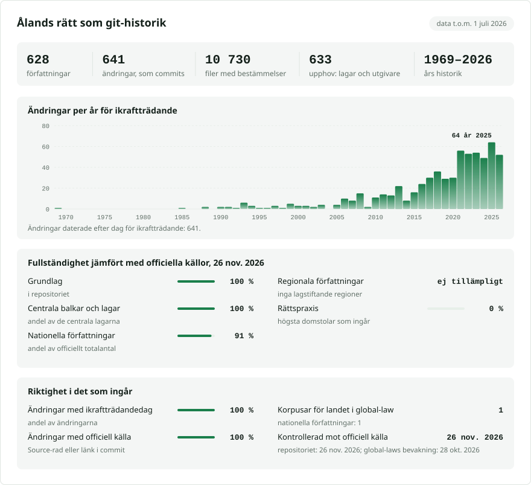

# Åland: författningarnas historik i git

**Svenska** · **[Or read it in English](README.en.md)**

<picture>
<source media="(prefers-color-scheme: dark)" srcset="data/sv/effort-dark.svg">

</picture>

Ålands lagstiftning som en git-historik: en fil per paragraf, en commit per version på den dag den trädde i kraft, och den lag som gjorde varje ändring som commitens författare (author). `git blame` anger lagen bakom varje rad; `git log` visar varje ändring i en paragraf; med ett valt datum får man den text som gällde den dagen.

En del av [lexifina/global-law](https://github.com/lexifina/global-law), en enda git-historik för alla länders rätt: detta är Ålands lagstiftning, som global-law läser under `aland/national/acts/`.

**Vad det innehåller nu:** 660 av de 690 texter som Ålex förtecknar: 496 gällande landskapslagar, landskapsförordningar och republikens presidents förordningar, och 164 föråldrade texter (under `<typ>/foraldrade/`). Grundlagarna: Självstyrelselag (1991:71) för Åland (`grundlag/sjalvstyrelselag/`, gällande text i Ålex enligt ÅFS 2020/33, i kraft från den 1 januari 2021; ändringarna förtecknade, inte återskapade) och Lagtingsordning (2011:97) för Åland (`grundlag/lagtingsordning/`, från den 1 november 2011 med alla 5 ändringar återskapade till den 1 januari 2024; slutläget kontrollerat mot Ålex, med ett angivet ställe där den följer ÅFS). Landskapslag (2015:68) om hemvårdsstöd (`landskapslagar/2015/2015-68-hemvardsstod/`) har också hela sin historik. Varje annan lag är sin gällande konsoliderade text i Ålex, en commit daterad den dag den senaste författning som texten visar trädde i kraft; tidigare lydelser är ännu inte återskapade.

| Mapp | Innehåll |
| --- | --- |
| `grundlag/` | Självstyrelselagen (`sjalvstyrelselag/`), lagtingsordningen (`lagtingsordning/`) och lagtingets arbetsordning (`arbetsordning/`) |
| `landskapslagar/<år>/<år>-<nr>-<kortnamn>/` | Landskapslagar, t.ex. `landskapslagar/1997/1997-73-kommunallag/` och `landskapslagar/2015/2015-68-hemvardsstod/` |
| `landskapsforordningar/<år>/…` | Landskapsförordningar, t.ex. `landskapsforordningar/2026/2026-43-skjutprov-for-jakt-pa-klovvilt/` |
| `presidentens-forordningar/<år>/…` | Republikens presidents förordningar (överenskommelseförordningar, före 1995 ”Förordning”) |
| `landskapsregeringens-beslut/<år>/…` | Ålands landskapsregerings beslut |
| `rikslagar/<år>/…` | Lag (2021:22) om avräkningsgrunden enligt självstyrelselagen |
| `<typ>/foraldrade/<år>/…` | Texter som Ålex förtecknar som föråldrad lagstiftning (upphävda eller tidsbundna och utgångna) |
| `data/` | Diagrammen, `paths.json` (varje mapp före och efter omläggningen den 26 november 2026) och `hemvardsstod-amendments.csv` |

I varje lagmapp finns en fil per paragraf (`paragraf-013.md`; `kap-02-paragraf-001.md` där paragraferna numreras om i varje kapitel), en per bilaga (`bilaga-01.md`) och `rubrik.md` med rubriken.

Texten är på svenska, Ålands officiella språk, så som författningssamlingen och Ålex återger den. En engelsk översättning ingår inte i detta repositorium.

## Frågor som git-kommandon

| Fråga | Kommando |
| --- | --- |
| Varje ändring i 13 § landskapslagen om hemvårdsstöd | `git log --follow -p --word-diff -- landskapslagar/2015/2015-68-hemvardsstod/paragraf-013.md` |
| Vilken lag skrev varje rad i 13 §? | `git blame landskapslagar/2015/2015-68-hemvardsstod/paragraf-013.md` |
| Varje version av lagen, med den dag då den trädde i kraft | `git log --format="%h %(trailers:key=In-force,valueonly,separator=) %an" -- landskapslagar/2015/2015-68-hemvardsstod hemvardsstod` |
| 13 § i den lydelse som gällde den 1 juni 2022 | `python tools/alex.py 2022-06-01 landskapslagar/2015/2015-68-hemvardsstod 13` |

**Utanför git** tillhandahåller vi också detta material offentligt och gratis:

- **[Fråga Claude om åländsk lagstiftning](https://global-law.lexifina.com/v1/try_claude?country=aland)**: öppnar Claude med en första fråga färdig.
- **[Fråga ChatGPT](https://global-law.lexifina.com/v1/try_chatgpt?country=aland)**: samma fråga i ChatGPT.
- **[Sök i åländsk lagstiftning på vår webbplats](https://lexifina.com/law?country=aland&q=hemv%C3%A5rdsst%C3%B6d)**: en sökning efter ”hemvårdsstöd”, med varje bestämmelses text och dess versioner, utan konto.
- **[REST-API för utvecklare](https://global-law.lexifina.com/v1/search_law?query=hemv%C3%A5rdsst%C3%B6d&jurisdiction=aland)**: samma sökning som JSON, utan nyckel. Dokumentationen finns [här](https://lexifina.com/api/global-law).

Båda assistenterna läser materialet genom den kostnadsfria kopplingen Global law (MCP, `https://global-law.lexifina.com/mcp`); första gången ger chatten dig länken som lägger till den. Fråga på svenska eller på engelska.

**Kör det enkelt själv.** Det enda som behövs är git och Python, och verktygen körs på din egen dator:

```sh
git clone --depth 1 https://github.com/lexifina/global-law && cd global-law
python3 tools/countries.py add aland/national/acts
python3 tools/law.py show 2026-01-01 aland/national/acts/landskapslagar/2015/2015-68-hemvardsstod/paragraf-013.md
```

Öppnad i Claude Code, Cursor, VS Code eller Codex startar klonen också en lokal MCP-server med samma verktyg ([MCP.md](https://github.com/lexifina/global-law/blob/main/MCP.md)).

## Datum

Varje commit dateras kl. 12.00 Mariehamnstid (Europe/Mariehamn) den dag versionen trädde i kraft, och dagen står i dess trailer `In-force:`:

- för varje version, den dag som lagens egen ikraftträdandebestämmelse i författningssamlingen anger (”Denna lag träder i kraft den 1 maj 2026.”), och den måste vara densamma som den dag Ålex anger; ingen lag här träder i kraft paragraf för paragraf;
- den dag lagen utfärdades står i en trailer `Enacted:`, och övergångsbestämmelser och retroaktiva bestämmelser i en ikraftträdandebestämmelse kopieras ordagrant till trailrar `Applies:` (ÅFS 2023/29 tillåter att hemvårdsstöd för syskon beviljas från den 1 augusti 2022).

En lag som bara finns som gällande text dateras den dag den senaste författning som Ålex visar för den trädde i kraft (trailern `In-force-basis:` anger varifrån dagen kommer) och tillskrivs den författningen.

Varje ändring tillskrivs den lag som gjorde den (`ÅFS 2022/56`, adress `afs-2022-56@regeringen.ax.invalid`), och den första versionen den ursprungliga lagen, `ÅFS 2015/68`; ingen version tillskrivs utgivaren.

## Hur det kontrolleras

- `tools/build.py` gör inga commits om inte det återskapade slutläget är lika med Ålex:s konsolidering (uppdaterad t.o.m. ÅFS 2026/31) i alla 30 paragrafer, efter den normalisering som [`REPRODUCE.md`](REPRODUCE.md) anger; en ändringsklausul som den inte kan läsa stoppar bygget.
- `tools/check_repo.py` läser tillbaka varje version ur git: den sista måste vara lika med Ålex, fil för fil och ord för ord (2 232 ord), den första med den ursprungliga lagen, och varje ändringslags paragrafer med dess egen text och ikraftträdandedag.
- `tools/current.py --verify` läser varje övrig lag ur git och jämför den med sin sida i Ålex, fil för fil och ord för ord, och författaren och `In-force:` med den senaste författning sidan visar.
- `tools/test_repo.py` kontrollerar blame, datumverktyget före och efter en ändring, `git log --follow` och taggarna; `tools/build.py --verify-rebuild` bygger materialet på nytt och måste ge samma hash för `main`. Resultaten finns i [`REPRODUCE.md`](REPRODUCE.md).
- [vulnerabilities/](vulnerabilities/): möjliga redaktionella fel i denna rätt, hittade av global-laws detektorer och kontrollerade för hand. Inte körd ännu.

## Vad det inte visar

- **Officiella tidigare lydelser.** De 6 versionerna mellan den ursprungliga lagen och den gällande texten är återskapade ur ändringslagarna och inte kontrollerade mot en officiell text.
- **28 av Ålex:s texter**: 18 där dagen bara står i en skannad ÅFS-PDF utan textlager (den läses inte med OCR), 5 där ÅFS-PDF:en inte hittades eller inte anger dagen, 2 med ikraftträdande i framtiden och 3 som parsern inte kunde läsa ord för ord. Bilder i lagtexten står som en rad `[Bild: <adress>]`. Tidigare lydelser för andra lagar än de tre ovan.
- **Rättspraxis, lagförslag och EU-rätt.**
- **Ändringar efter den 26 november 2026**, den dag Ålex senast lästes.

## Källor

| Källa | Typ | Tidigare lydelser | Anmärkningar |
| --- | --- | --- | --- |
| [Ålex](https://www.regeringen.ax/alandsk-lagstiftning) (Ålands landskapsregering) | Konsoliderad lagstiftning | nej, bara den gällande konsolideringen | Slutläget kontrolleras mot den, och varje ikraftträdandedag mot dess förteckning över ikraftträdandebestämmelser; den är informativ, bara ÅFS är auktoritativ |
| Ålands författningssamling (ÅFS), PDF-filer på samma webbplats | Författningssamling | så som de publicerats: den ursprungliga lagen och varje ändringslag | Den auktoritativa texten; varje version byggs ur den |

## Licens

Se [`LICENSE`](LICENSE). Inga licenser eller användarvillkor för texterna hittades på regeringen.ax; författningar omfattas i regel inte av upphovsrätt i Finland (9 § upphovsrättslagen 404/1961), som gäller på Åland. De återskapade versionerna är härledda ur dessa data och publiceras inte av Ålands landskapsregering. Historiken, commit-meddelandena, tabellerna och verktygen omfattas av CC0 1.0.

Ingen modell har skrivit lagtext eller körts när materialet byggs; koden skrevs med Claude, en AI-modell (se [`REPRODUCE.md`](REPRODUCE.md)).

Detta är en översättning av den engelska versionen ([README.en.md](README.en.md)); om de skiljer sig åt gäller den engelska versionen.

## Visualiseringar

- [visualisations/](visualisations/): diagram ritade ur detta repository. Inte ritade ännu.

## Mer

Från repositoriet [lexifina/global-law](https://github.com/lexifina/global-law) (på engelska):

- [FEATURES.md](https://github.com/lexifina/global-law/blob/main/FEATURES.md): alla funktioner och vad varje korpus måste stödja (`git blame`, `law.py`, MCP-verktyg)
- [FAQ.md](https://github.com/lexifina/global-law/blob/main/FAQ.md): frågor och svar · [CONTRIBUTING.md](https://github.com/lexifina/global-law/blob/main/CONTRIBUTING.md): föreslå ändringar · [MCP.md](https://github.com/lexifina/global-law/blob/main/MCP.md): MCP-server · [REPRODUCE.md](https://github.com/lexifina/global-law/blob/main/REPRODUCE.md): hur det är byggt · [CHANGELOG.md](https://github.com/lexifina/global-law/blob/main/CHANGELOG.md)
- [FRESHNESS.md](https://github.com/lexifina/global-law/blob/main/FRESHNESS.md): hur aktuellt varje korpus är · [Övervakning](https://github.com/lexifina/global-law/tree/main/monitoring): om uppdateringarna fungerar · [WATCHING.md](https://github.com/lexifina/global-law/blob/main/WATCHING.md): hur varje officiell källa bevakas för ändringar
- [performance/](https://github.com/lexifina/global-law/tree/main/performance): hur snabba verktygen är, uppmätt
- [visualisations/](https://github.com/lexifina/global-law/tree/main/visualisations): diagram och kopplingar över hela världens rätt
- [Sårbarheter](https://github.com/lexifina/global-law/tree/main/vulnerabilities): fel i författningar så som de publicerats
