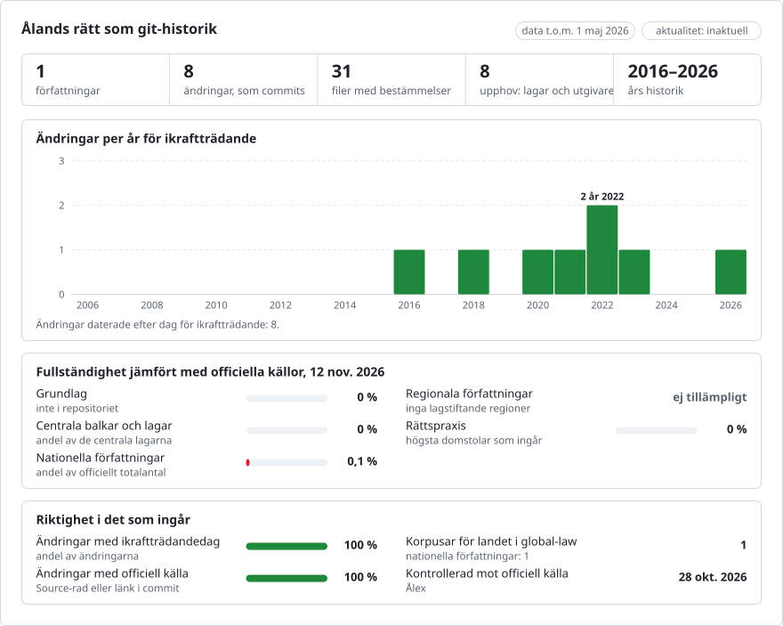

# Åländsk lagstiftning, ändring för ändring

**Svenska** · [English](README.en.md)

<picture>
<source media="(prefers-color-scheme: dark)" srcset="data/sv/effort-dark.svg">

</picture>

En del av [lexifina/global-law](https://github.com/lexifina/global-law), en enda git-historik för alla länders rätt: detta är AX:s nationella lagstiftning, som global-law läser under `aland/national/acts/`.

Landskapslag (2015:68) om hemvårdsstöd som git-repositorium. Varje ändringslag är en commit,
som tillskrivs den lagen och dateras till den dag då den trädde i kraft, kl. 12.00 Mariehamnstid. Texten är på svenska.

**De mellanliggande versionerna är återskapade. Endast slutläget kontrolleras mot en officiell konsolidering.** Ålex tillhandahåller endast den GÄLLANDE konsoliderade lydelsen av en lag. De mellanliggande versionerna i detta repositorium är därför ÅTERSKAPADE: den ursprungliga lagen hämtas ur dess PDF i Ålands författningssamling (ÅFS), och varje ändringslag tillämpas, i ikraftträdandeordning, genom att paragrafer, moment, punkter och rubriker ersätts och moment och paragrafer införs, så som lagens egen ingress anger. Endast slutläget kontrolleras mot en officiell konsolidering (Ålex); de tidigare versionerna har inte bekräftats oberoende.

## Frågorna som git-kommandon

| Fråga | Kommando |
| --- | --- |
| Vad sade 1 § den 1 juni 2021? | `python tools/alex.py 2021-06-01 hemvardsstod 1` |
| Hela lagen i den lydelse den hade den 1 januari 2019 | `python tools/alex.py 2019-01-01 hemvardsstod` |
| Vilken lag skrev varje rad i 13 §? | `git blame hemvardsstod/paragraf-013.md` |
| Varje ändring av 13 §, med lagen och dagen | `git log --follow hemvardsstod/paragraf-013.md` |
| Allt som en lag ändrade | `git show --stat hemvardsstod/2022-56` |
| Ändringslagarna med alla sina datum | [`amendments.csv`](amendments.csv) |
| Commits med evidensraden för återskapandet | `git log --grep="Evidence: replay"` |
| Lagar som ändrade 7 § | `git log --format="%an %ad" --date=short -- hemvardsstod/paragraf-007.md` |
| Ändringar med en övergångsbestämmelse eller retroaktiv bestämmelse | `git log --grep="^Applies:"` |
| Alla taggar, en per lag | `git tag --list "hemvardsstod/*"` |

## Datumen, och vilket vi använder

En åländsk lag har en dag då den undertecknades (`Enacted:`, "Utfärdad i Mariehamn den ...") och en dag då den träder i kraft
(`In-force:`). **Commits dateras till den dag då ändringen trädde i kraft**, kl. 12.00 Mariehamnstid (EET, eller EEST under sommartid).
Varje ikraftträdandedag läses två gånger och måste stämma överens: ur Ålex:s förteckning över ikraftträdandebestämmelser och ur
ändringslagens egen text i författningssamlingen. Ingen lag här träder i kraft stegvis per paragraf. Övergångsbestämmelser och
retroaktiva bestämmelser i en ikraftträdandebestämmelse kopieras ordagrant till trailrar `Applies:`; de förarbeten som Ålex förtecknar läggs i `Preparatory-works:`.

## Vad "author" betyder

Författaren (author) till en commit är den lag som gjorde ändringen (`ÅFS 2022/56`, adress `afs-2022-56@regeringen.ax.invalid`), så att
`git blame` anger lagen. Committern är alltid `Lexifina`.

## Ändringslagar

| Lag | I kraft | Paragrafer |
| --- | --- | --- |
| ÅFS 2017/126 | 2018-01-01 | 25 |
| ÅFS 2020/63 | 2020-09-01 | 22a |
| ÅFS 2020/54 | 2021-01-01 | 1 |
| ÅFS 2021/104 | 2022-01-01 | 27 |
| ÅFS 2022/56 | 2022-08-01 | 1, 7, 8, 9, 11, 13, 14, 15, 28 |
| ÅFS 2023/29 | 2023-05-01 | 7, 13 |
| ÅFS 2026/31 | 2026-05-01 | 21 |

## Hur det kontrolleras

`tools/build.py` avbryts om inte det återskapade slutläget är lika med Ålex:s konsolidering (uppdaterad t.o.m. ÅFS 2026/31) för alla
30 paragrafer, efter följande normalisering: (1) blanktecken: hårda mellanslag, em-mellanslag och tabbar läses som mellanslag, följder av blanktecken som ett mellanslag, mjuka bindestreck (U+00AD) tas bort och ett ord som avstavats vid radslut sammanfogas; (2) Ålex: inbäddad märkning (länkar, betoning) sammanfogas utan mellanslag, ändringsbeteckningar som "(2022/56)" tas bort, och de redaktionella anmärkningarna (div "anmarkning", t.ex. under 21 §) är inte lagtext; (3) ÅFS-PDF: ett omappat tecken (U+FFFD) före ett avstavningsstreck vid radslut är den dubblerade konsonanten vid en avstavning av en svensk trekonsonantförbindelse ("til-lämpning"), så ordet sammanfogas så som det skrivs utan avstavning ("tillämpning"); utgivarens sidhuvuden, sidfötter, underskrifter och fotnoter tas bort utifrån innehållet.
`tools/check_repo.py` läser sedan tillbaka varje version ur git och jämför den sista med Ålex (fil för fil och
ord för ord), den första med den ursprungliga lagen och varje ändringslags paragrafer med ändringslagens egen text.
`tools/test_repo.py` kontrollerar att kommandona ovan fungerar. Se [`REPRODUCE.md`](REPRODUCE.md).
- check_repo.py: slutlig version jämfört med Ålex (uppdaterad t.o.m. ÅFS 2026/31): 30 paragrafer, 0 avvikelser, ordkontrollen lika (2 232 ord); första versionen jämfört med den ursprungliga lagen: lika; 7 ändringslagar kontrollerade mot sin egen text och sina ikraftträdandedagar; 0 problem
- test_repo.py: 6/6 godkända

## Filer

`hemvardsstod/paragraf-NNN.md` är en paragraf; `#`-raden är dess nummer och rubrik, `Kapitel:` dess kapitel, och
varje moment är ett block som avgränsas av en tom rad, där varje rad är ett textstycke eller en numrerad punkt. `rubrik.md` är
lagens rubrik och ingressen. En upphävd paragraf tas bort.

## Vad det inte visar

- Versioner som Ålex inte publicerar: endast den gällande konsoliderade lydelsen finns; resten är återskapat.
- Landskapslag (2017:120) om landskapsandelar till kommunerna har inte byggts: tre av dess ändringslagar är tidsbegränsade
  (2020/50, 2021/136, 2022/67, med dagar då de upphör att gälla) och Ålex anger inget ikraftträdande för 2018/102.
- Självstyrelselagen (Självstyrelselag 1991:71 för Åland) är en finländsk lag som publiceras av Finlex, inte i ÅFS.

## Licens

Se [`LICENSE`](LICENSE): inga användarvillkor hittades; repositoriet förblir privat. Verktyg, historik och tabeller: CC0.

Detta är en översättning av den engelska versionen ([README.en.md](README.en.md)); om de skiljer sig åt gäller den engelska versionen.

## Källa

Ålands landskapsregering, https://www.regeringen.ax/alandsk-lagstiftning : Ålex (konsoliderade texter, HTML) och Ålands
författningssamling (PDF).

## Mer

Från repositoriet [lexifina/global-law](https://github.com/lexifina/global-law) (på engelska):

- [FEATURES.md](https://github.com/lexifina/global-law/blob/main/FEATURES.md): alla funktioner och vad varje korpus måste stödja (`git blame`, `law.py`, MCP-verktyg)
- [FAQ.md](https://github.com/lexifina/global-law/blob/main/FAQ.md): frågor och svar · [CONTRIBUTING.md](https://github.com/lexifina/global-law/blob/main/CONTRIBUTING.md): föreslå ändringar · [MCP.md](https://github.com/lexifina/global-law/blob/main/MCP.md): MCP-server · [REPRODUCE.md](https://github.com/lexifina/global-law/blob/main/REPRODUCE.md): hur det är byggt · [CHANGELOG.md](https://github.com/lexifina/global-law/blob/main/CHANGELOG.md)
- [FRESHNESS.md](https://github.com/lexifina/global-law/blob/main/FRESHNESS.md): hur aktuellt varje korpus är · [Övervakning](https://github.com/lexifina/global-law/tree/main/monitoring): om uppdateringarna fungerar · [WATCHING.md](https://github.com/lexifina/global-law/blob/main/WATCHING.md): hur varje officiell källa bevakas för ändringar
- [performance/](https://github.com/lexifina/global-law/tree/main/performance): hur snabba verktygen är, uppmätt
- [visualisations/](https://github.com/lexifina/global-law/tree/main/visualisations): diagram och kopplingar över hela världens rätt
- [Sårbarheter](https://github.com/lexifina/global-law/tree/main/vulnerabilities): fel i författningar så som de publicerats
